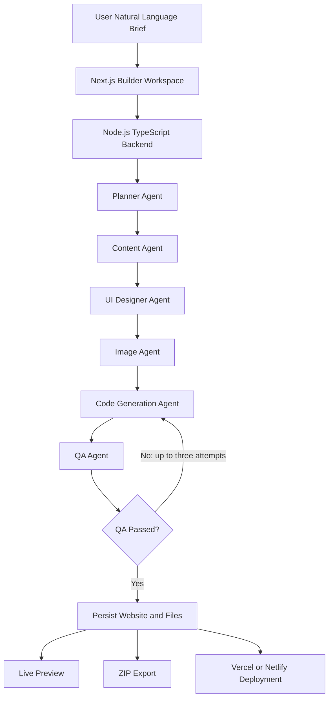
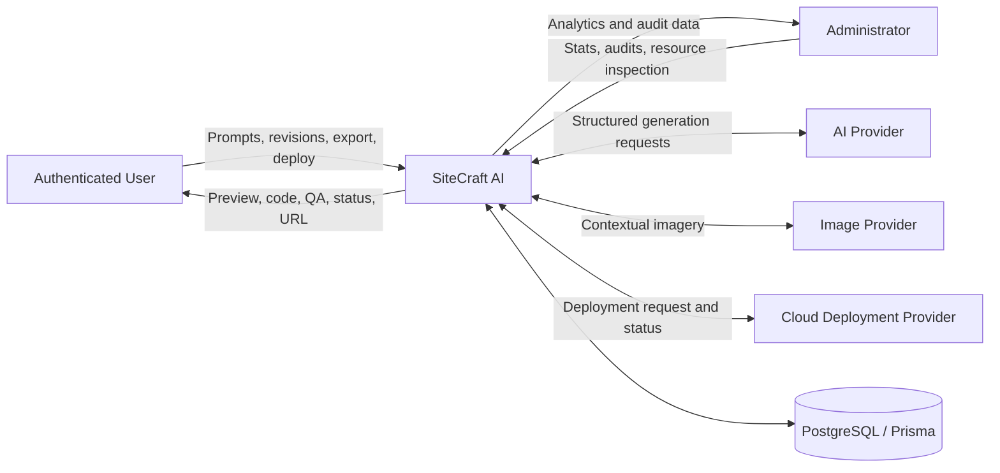
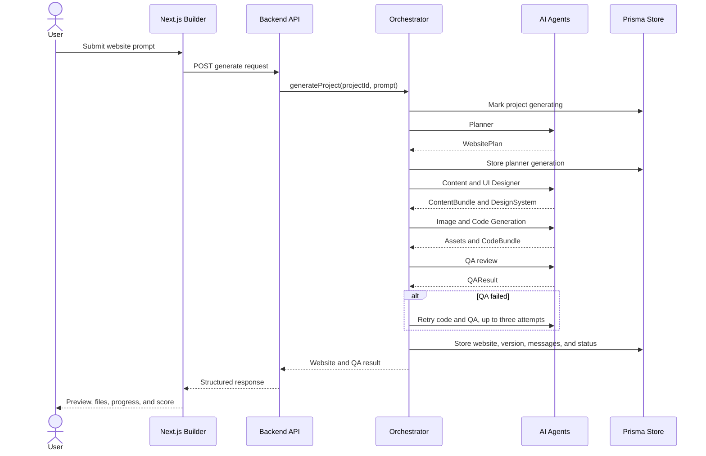
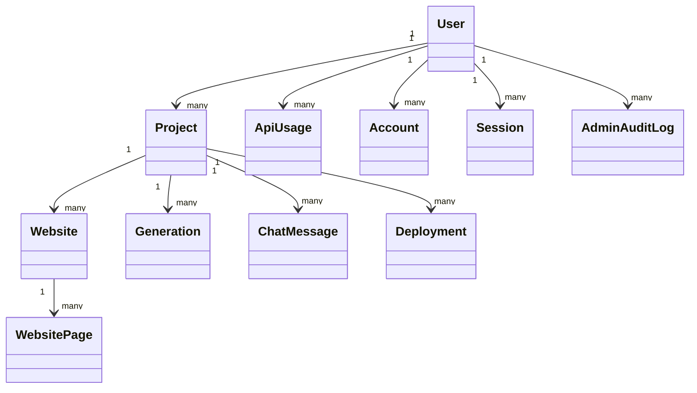
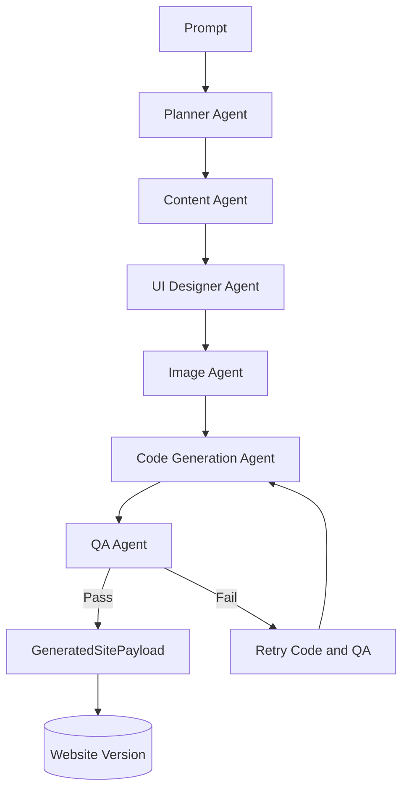
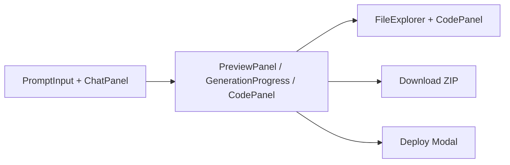

# SITECRAFT AI - AUTONOMOUS PROMPT-TO-WEBSITE GENERATION AGENT

## A Phase 1 Progress Report

Submitted in partial fulfilment of the requirements for the award of the degree of

## Bachelor of Technology

in

## Computer Science and Engineering

### Specialization in Artificial Intelligence and Machine Learning

**By**

`[Student Name 1] ([University Roll No.])`  
`[Student Name 2] ([University Roll No.])`

**Group No. `[Group Number]`**

**Under the Guidance of**  
`[Supervisor Name]`

`[Department Name]`  
`[Institute Name]`  
`[University Name]`

`[City, State, Country]`  
`[Month, Year]`

---

# DECLARATION

We hereby declare that the work presented in the B.Tech. project **"SiteCraft AI - Autonomous Prompt-to-Website Generation Agent"**, in partial fulfilment of the requirements for the award of the Bachelor of Technology in Computer Science and Engineering with specialization in Artificial Intelligence and Machine Learning, is an authentic record of our own work carried out under the supervision of `[Supervisor Name]`.

The contents of this project report, in full or in parts, have not been submitted to any other institute or university for the award of any degree.

| Sign | Sign |
|---|---|
| Name of candidate: `[Student Name 1]` | Name of candidate: `[Student Name 2]` |
| University Roll No.: `[Roll No. 1]` | University Roll No.: `[Roll No. 2]` |
| Course: B.Tech. CSE (AIML) | Course: B.Tech. CSE (AIML) |

---

# CERTIFICATE

This is to certify that the statements made by the candidates in the project report **"SiteCraft AI - Autonomous Prompt-to-Website Generation Agent"** are correct to the best of my knowledge and belief. The project has been carried out under my supervision and is submitted in partial fulfilment of the requirements for the award of the Bachelor of Technology degree.

| Supervisor | Project Co-ordinator | Program Co-ordinator |
|---|---|---|
| `[Supervisor Name]`  
`[Designation]`  
`[Department]` | `[Project Co-ordinator]`  
`[Designation]` | `[Program Co-ordinator]`  
`[Designation]` |

**Date:** `[Date]`

---

# ACKNOWLEDGEMENT

We express our sincere gratitude to everyone who supported and guided us during the development of SiteCraft AI. We are especially thankful to our project guide, `[Supervisor Name]`, for continuous encouragement, valuable feedback, and technical direction throughout the planning, implementation, and testing of the project.

We are grateful to the Department of `[Department Name]` and `[Institute Name]` for providing the academic environment, computing resources, and facilities required to develop and evaluate this system. The project strengthened our understanding of full-stack application engineering, artificial intelligence workflows, structured generation, database design, and cloud deployment.

We also thank the faculty members, classmates, and friends who provided suggestions during requirement analysis and usability review. Finally, we express our deepest appreciation to our families for their patience, motivation, and constant support.

| `[Student Name 1]` | `[Student Name 2]` |
|---|---|
| `[Roll No. 1]` | `[Roll No. 2]` |

---

# ABSTRACT

SiteCraft AI is an autonomous prompt-to-website generation platform designed to reduce the time and technical effort required to create a complete modern website. Traditional website development requires separate activities such as requirement interpretation, information architecture, copywriting, visual design, asset selection, component implementation, responsive styling, accessibility review, and deployment preparation. These activities are often fragmented across tools and require users to possess considerable design and programming knowledge.

SiteCraft AI addresses this problem through a coordinated multi-agent generation pipeline. A user provides a natural-language website brief, after which the system creates a structured website plan, generates content, defines a design system, finds contextual visual assets, produces a multi-file React and TypeScript code bundle, and evaluates the generated result through a quality-assurance agent. The system validates intermediate outputs with Zod schemas and records agent activity for traceability.

The platform provides a unified workspace for project creation, conversational revision, live sandboxed preview, responsive device inspection, generated-code browsing, file exploration, ZIP export, and cloud deployment. Users can request changes such as a new color direction, a shorter hero section, or an additional pricing section without losing the existing project state. The revision flow preserves the previous website version, applies an incremental update, runs quality checks, and stores the new result.

The architecture consists of a Next.js App Router frontend, a Node.js and TypeScript backend, a PostgreSQL database managed through Prisma ORM, and an AI provider abstraction supporting configured hosted providers and a local fallback mode. The system also includes authentication, role-aware administration, API usage tracking, audit records, and deployment adapters for Vercel and Netlify. When an external model is unavailable, the platform falls back to deterministic local generation for core planning, design, content, code, and QA operations.

SiteCraft AI demonstrates how structured multi-agent orchestration can turn an informal creative brief into an editable and deployable web project. The system provides a foundation for future work including richer visual validation, more framework targets, persistent collaborative editing, automated accessibility scoring, and broader deployment provider support.

---

# TABLE OF CONTENTS

| Section | Title |
|---|---|
| 1 | Declaration |
| 2 | Certificate |
| 3 | Acknowledgement |
| 4 | Abstract |
| 5 | Table of Contents |
| 6 | List of Tables |
| 7 | List of Figures |
| Chapter 1 | Introduction |
| 1.1 | Overview and Motivation |
| 1.2 | Objectives |
| 1.3 | Summary of Similar Applications |
| 1.4 | Organization of the Project Report |
| Chapter 2 | Software Requirement Analysis |
| 2.1 | Introduction to Requirement Analysis |
| 2.2 | Feasibility Study |
| 2.3 | Functional Requirements |
| 2.4 | Non-Functional Requirements |
| 2.5 | Use Case Descriptions |
| 2.6 | Module Descriptions |
| Chapter 3 | Software Design |
| 3.1 | System Architecture Overview |
| 3.2 | Data Flow Diagrams |
| 3.3 | UML and Workflow Diagrams |
| 3.4 | Database Design |
| Chapter 4 | Implementation and User Interface |
| 4.1 | Technology Stack Used |
| 4.2 | AI Architecture |
| 4.3 | Frontend Implementation |
| 4.3.1 | Authentication and Dashboard |
| 4.3.2 | Builder Workspace |
| 4.3.3 | Generated Preview and Code UI |
| 4.3.4 | Administration and Settings |
| Chapter 5 | Software Testing |
| 5.1 | Agent and Pipeline Testing |
| 5.2 | Testing Approaches |
| 5.3 | Test Case Specifications |
| 5.4 | Provider, Fallback, and Deployment Testing |
| Chapter 6 | Conclusion |
| Chapter 7 | Summary |
| References | References |
| Appendix A | Abbreviations |
| Appendix B | Sample API Endpoints |

---

# LIST OF TABLES

| Table | Description |
|---|---|
| Table 2.1 | Comparison of Existing Website Creation Approaches |
| Table 2.2 | Feasibility Study Summary |
| Table 2.3 | Functional Requirements of SiteCraft AI |
| Table 2.4 | Non-Functional Requirements of SiteCraft AI |
| Table 2.5 | Use Case: User Generates a Website |
| Table 2.6 | Use Case: User Revises a Generated Website |
| Table 2.7 | Use Case: User Deploys a Website |
| Table 3.1 | Database Table - Users |
| Table 3.2 | Database Table - Projects |
| Table 3.3 | Database Table - Websites and Pages |
| Table 3.4 | Database Table - Generations |
| Table 3.5 | Database Table - Deployments |
| Table 4.1 | Technology Stack Summary |
| Table 4.2 | Multi-Agent Generation Layer - Agent Responsibilities |
| Table 4.3 | Generated Output Contract |
| Table 5.1 | Unit and Integration Testing Summary |
| Table 5.2 | Black Box Test Cases - Project and Builder Module |
| Table 5.3 | White Box Test Cases - Generation Pipeline |
| Table 5.4 | Provider and Deployment Test Cases |

---

# LIST OF FIGURES

| Figure | Description |
|---|---|
| Figure 1.1 | System Architecture of SiteCraft AI |
| Figure 3.1 | Level 0 DFD - Context Diagram |
| Figure 3.2 | Website Generation Sequence |
| Figure 4.1 | Multi-Agent Generation Architecture |
| Figure 4.2 | Builder Workspace Layout |
| Figure 4.3 | Generation Progress and QA Output |
| Figure 4.4 | Generated Website Preview and Device Modes |
| Figure 4.5 | Code Explorer and File Browser |
| Figure 5.1 | Automated Test Execution Output |

---

# CHAPTER 1: INTRODUCTION

## 1.1 Overview and Motivation

Websites are now essential for businesses, institutions, creators, community groups, and early-stage products. However, producing a polished website still requires coordination between multiple skills. A project owner must describe the purpose of the website, define its pages, choose a visual direction, prepare content, select imagery, implement responsive components, test the result, and configure deployment.

The traditional process creates several difficulties:

- **Requirement translation difficulty:** Non-technical users may know what they want to communicate but may not know how to express it as routes, components, states, and responsive rules.
- **Fragmented development workflow:** Planning, copywriting, design, coding, preview, and deployment are usually handled by different tools.
- **Slow iteration:** Small changes often require editing several files and manually checking the result across multiple viewports.
- **Inconsistent quality:** Generated or manually assembled websites may omit responsive metadata, semantic landmarks, accessible labels, documentation, or package configuration.
- **Asset selection overhead:** Finding suitable imagery and connecting it to generated content is time-consuming.
- **Deployment preparation:** A working local page may still require packaging, configuration, provider credentials, and deployment status handling.
- **Limited traceability:** Users may not know which stage produced an output or why a generated result failed.

SiteCraft AI is developed to solve these issues by treating website creation as a coordinated software-generation workflow. The system converts a natural-language prompt into a structured plan and passes that plan through specialized agents. Each agent has a focused responsibility, while the orchestrator controls ordering, validation, persistence, retries, and final assembly.

### Why This Project?

As generative AI becomes part of software development, a useful website-generation platform must produce more than an isolated code fragment. It should preserve structure, support revision, expose generated files, provide visual feedback, and help users move from idea to deployable output.

SiteCraft AI contributes by:

- Converting an informal prompt into a validated website plan.
- Generating content and visual structure as separate, inspectable artifacts.
- Creating modular React and TypeScript files rather than only a single text response.
- Providing contextual image assets through an image-agent integration with fallback behavior.
- Running a QA stage that checks semantic markup, viewport metadata, accessibility hints, and export files.
- Supporting conversational revisions while retaining project and website versions.
- Offering a live preview, code explorer, file explorer, ZIP export, and cloud deployment workflow.
- Recording generation activity, provider usage, chat messages, deployments, and administrative audit data.

**Figure 1.1: System Architecture of SiteCraft AI**



## 1.2 Objectives

### Completed or Implemented Objectives

1. To develop an autonomous website-generation workflow driven by a natural-language prompt.
2. To implement a planner agent that extracts the site name, description, pages, themes, colors, features, and font direction.
3. To generate structured website content including hero copy, sections, testimonials, FAQs, and SEO metadata.
4. To define a design system containing layout guidance, component hierarchy, design tokens, and responsive rules.
5. To generate multi-file HTML, React, TypeScript, CSS, JSON, Markdown, and related project assets.
6. To provide a QA stage that validates key website and export requirements.
7. To provide a conversational revision workflow for incremental changes to an existing website.
8. To provide responsive live preview modes for desktop, tablet, and mobile inspection.
9. To provide a code panel and file explorer for generated project inspection.
10. To support ZIP export of a generated project.
11. To provide Vercel and Netlify deployment adapters with status and error handling.
12. To implement PostgreSQL persistence with Prisma ORM and a persistent local JSON fallback for database maintenance scenarios.
13. To provide authenticated user access, user/admin roles, API usage records, and administration endpoints.
14. To maintain generation records and chat history for traceability.

### Pending or Future Objectives

- Add richer automated browser-based visual regression analysis for generated previews.
- Add direct editing of generated files with version-aware conflict handling.
- Add collaborative multi-user project editing.
- Add more deployment providers and deployment logs.
- Add framework targets beyond the current Next.js, React, and Tailwind-oriented output.
- Add formal accessibility scoring using automated browser audits.
- Add project templates, reusable design systems, and organization-level workspaces.
- Add export formats for documentation and project reports.

## 1.3 Summary of Similar Applications

Website builders, visual editors, code assistants, and generative AI tools each solve part of the website-development problem. The central distinction of SiteCraft AI is the combination of structured multi-agent planning, content and design generation, code packaging, QA review, conversational revision, and deployment preparation in one workflow.

| Platform or Approach | Key Features | Structured Multi-Agent Workflow | Editable Multi-File Output | Deployment Support | Limitations |
|---|---|---:|---:|---:|---|
| Traditional manual development | Full control, established tools | No | Yes | Depends on developer | Requires substantial technical and design effort |
| Visual website builders | Drag-and-drop pages and templates | No | Limited | Usually available | Less control over generated code and custom workflows |
| Code assistants | Code completion and chat-based suggestions | Partial | Yes | Usually external | User must assemble, test, and package the application |
| Template generators | Predefined layouts and themes | No | Sometimes | Varies | Limited adaptation to open-ended prompts |
| SiteCraft AI | Prompt-driven planning, content, design, assets, code, QA, revision | Yes | Yes | Vercel and Netlify adapters | Ongoing enhancement of visual and framework coverage |

SiteCraft AI is therefore positioned as an autonomous project-generation environment rather than only a code completion tool or a static template library.

## 1.4 Organization of the Project Report

This project report is organized into seven chapters:

- **Chapter 1 - Introduction:** Explains the motivation, objectives, comparison with existing approaches, and report organization.
- **Chapter 2 - Software Requirement Analysis:** Defines feasibility, functional requirements, non-functional requirements, use cases, and modules.
- **Chapter 3 - Software Design:** Presents the architecture, data-flow model, generation sequence, and database design.
- **Chapter 4 - Implementation and User Interface:** Describes the technology stack, AI agents, backend orchestration, frontend workspace, export, and deployment features.
- **Chapter 5 - Software Testing:** Documents unit, integration, black box, provider, fallback, and deployment tests.
- **Chapter 6 - Conclusion:** Summarizes the current system, achievements, constraints, and future work.
- **Chapter 7 - Summary:** Provides a consolidated account of the project.
- **References:** Lists the technical sources and documentation used.
- **Appendices:** Provides abbreviations and representative API endpoints.

---

# CHAPTER 2: SOFTWARE REQUIREMENT ANALYSIS

## 2.1 Introduction to Requirement Analysis

Software requirement analysis identifies the expected users, system boundaries, data flows, quality attributes, and operational constraints of a software product. For SiteCraft AI, the analysis focuses on users who want to create websites from descriptions and need a workflow that remains understandable even when the internal AI pipeline is complex.

The system has two primary user roles: a standard user who creates and manages personal projects, and an administrator who monitors platform activity and usage. The website-generation workflow also interacts with external AI providers, image providers, cloud deployment providers, and the PostgreSQL database.

The main requirement gap is not merely the absence of an AI model. The gap is the absence of an integrated process that turns a prompt into a validated, editable, previewable, exportable, and deployable project. SiteCraft AI therefore treats planning, generation, QA, revision, and delivery as one connected system.

## 2.2 Feasibility Study

| Feasibility Type | Description | Analysis | Conclusion |
|---|---|---|---|
| Technical Feasibility | Availability of AI, web, database, and deployment technologies | Next.js, TypeScript, Prisma, PostgreSQL, schema validation, hosted model APIs, and REST deployment APIs are mature and suitable. | Feasible |
| Operational Feasibility | Usability for non-technical and technical users | A prompt input, progress view, live preview, code explorer, and conversational revision flow reduce the need to switch between tools. | Highly Feasible |
| Economic Feasibility | Development and operating cost | The system supports several providers and a local fallback. Optional integrations can be enabled only when required. | Cost-Effective |
| Legal and Security Feasibility | Protection of accounts, prompts, generated projects, and credentials | Authentication, server-side provider secrets, role checks, input validation, and project authorization reduce common exposure risks. | Feasible with continued security review |
| Schedule Feasibility | Ability to build within an academic project schedule | The modular workspace, backend, ML package, and persistence layer can be developed and tested in independent increments. | Feasible |

## 2.3 Functional Requirements

| S.No. | Requirement | Description |
|---:|---|---|
| 1 | User Registration | The system allows a user to create an account with name, email, and password. |
| 2 | User Login | The system authenticates a user and exposes role-aware session information. |
| 3 | Project Creation | A user can create a project with a name, description, framework, and initial website prompt. |
| 4 | Project Listing | Authenticated users can view their projects and project statuses. |
| 5 | Website Planning | The Planner Agent converts the prompt into a validated website plan. |
| 6 | Content Generation | The Content Agent produces hero copy, sections, calls to action, testimonials, FAQs, and SEO metadata. |
| 7 | Design Generation | The UI Designer Agent produces layout, component hierarchy, tokens, and responsive rules. |
| 8 | Image Retrieval | The Image Agent obtains contextual image assets when an image provider is configured and uses resilient fallback behavior otherwise. |
| 9 | Code Generation | The Code Generation Agent creates HTML and multi-file project output. |
| 10 | QA Review | The QA Agent or local QA checks semantic landmarks, viewport metadata, accessibility hints, README, and package files. |
| 11 | Retry Handling | Failed QA results may trigger additional code and QA attempts up to the configured retry limit. |
| 12 | Live Preview | The user can inspect generated output in an isolated preview workspace. |
| 13 | Device Modes | The preview supports desktop, tablet, and mobile viewport modes. |
| 14 | Conversational Revision | The user can request changes to a generated website without creating a new project. |
| 15 | Code and File Explorer | The user can inspect generated files and select individual files for viewing. |
| 16 | ZIP Export | The system packages generated files into a downloadable ZIP archive. |
| 17 | Cloud Deployment | The system can send generated files to configured Vercel or Netlify adapters. |
| 18 | Generation History | Agent inputs, outputs, status, errors, and timestamps are recorded. |
| 19 | Administration | Administrators can inspect users, projects, websites, generations, usage, deployments, chats, activity, and audit logs. |
| 20 | Provider Configuration | The system reports configured providers and active model status. |

## 2.4 Non-Functional Requirements

| S.No. | Requirement | Description |
|---:|---|---|
| 1 | Performance | The interface should provide clear progress feedback while generation and deployment operations are running. |
| 2 | Scalability | The backend and persistence layer should support multiple users, projects, generations, and website versions without coupling data to a single browser session. |
| 3 | Security | Provider API keys must remain server-side. Protected routes require authenticated identity and administrator routes require the ADMIN role. |
| 4 | Reliability | If a configured AI provider fails or returns invalid structured output, the system should use validated fallback behavior where supported. |
| 5 | Maintainability | Agents, schemas, provider adapters, deployment adapters, UI panels, and persistence operations should remain modular. |
| 6 | Usability | A first-time user should be able to submit a prompt, monitor progress, inspect a preview, revise the result, and export the project. |
| 7 | Portability | Generated projects should contain source files and package documentation suitable for local installation and development. |
| 8 | Traceability | Generation records, chat messages, API usage, deployments, and audit logs should preserve an operational history. |
| 9 | Accessibility | Generated output and the platform interface should use semantic structure, labels, responsive metadata, and accessible controls. |
| 10 | Data Integrity | Zod schemas and Prisma relations should prevent malformed plan, content, design, code, QA, and persistence records. |

## 2.5 Use Case Descriptions

### Use Case 1: User Generates a Website

| Field | Detail |
|---|---|
| Use Case ID | UC-01 |
| Use Case Name | User Generates a Website from a Prompt |
| Actor | Authenticated User |
| Precondition | The user is authenticated and has a project with an initial prompt. |
| Main Flow | 1. User opens the Builder. 2. User enters or confirms a natural-language website brief. 3. The backend records the prompt. 4. Planner, Content, UI Designer, Image, Code, and QA stages execute. 5. Intermediate agent records are stored. 6. The system assembles the generated site and stores the website. 7. The Builder displays preview, agent output, and generated files. |
| Alternate Flow | If no external provider is configured, local generation functions produce validated fallback output. |
| Postcondition | The project is marked ready when generation completes and the generated website is persisted with QA information. |
| Exception | Invalid input, provider failure, or unrecoverable generation error returns a structured error and marks the project failed where appropriate. |

### Use Case 2: User Revises a Generated Website

| Field | Detail |
|---|---|
| Use Case ID | UC-02 |
| Use Case Name | User Applies a Conversational Website Revision |
| Actor | Authenticated User |
| Precondition | The project already contains a generated website. |
| Main Flow | 1. User enters a revision such as a color, typography, content, or section request. 2. The backend records the chat message. 3. A revision agent or local revision function updates the existing plan and code. 4. QA is executed. 5. A new website version is saved. 6. The Builder refreshes the preview and file list. |
| Alternate Flow | If the configured provider cannot return a valid response, the system applies supported local incremental changes. |
| Postcondition | The revised website is stored with an incremented version number and updated QA result. |
| Exception | Revision attempted before initial generation returns an error requiring the user to generate a website first. |

### Use Case 3: User Deploys a Website

| Field | Detail |
|---|---|
| Use Case ID | UC-03 |
| Use Case Name | User Deploys Generated Project |
| Actor | Authenticated User |
| Precondition | A generated website exists and the selected deployment provider is configured. |
| Main Flow | 1. User selects Deploy. 2. The frontend requests deployment. 3. The backend packages the generated files. 4. The selected Vercel or Netlify adapter calls the provider API. 5. Deployment status and URL are returned. 6. The deployment record is stored and shown in the modal. |
| Alternate Flow | If a provider token is absent, the adapter returns configuration guidance rather than sending an incomplete request. |
| Postcondition | A deployment record exists with PENDING, BUILDING, READY, or ERROR status. |
| Exception | Provider API error or malformed response is converted into a user-visible deployment error. |

## 2.6 Module Descriptions

### Module 1: Authentication and User Module

This module supports registration, login, session identity, and user roles. It integrates with NextAuth/Auth.js on the frontend and backend user records. Password-based registration is validated before persistence, and protected project routes use the current user identity.

### Module 2: Project and Website Management Module

This module creates, lists, retrieves, updates, and deletes user projects. A project contains the initial prompt, status, framework, website versions, generation records, chat messages, and deployment records.

### Module 3: AI Generation and Orchestration Module

This is the central intelligence module. It coordinates Planner, Content, UI Designer, Image, Code Generation, and QA operations. The orchestrator validates outputs, stores generation records, retries QA failures, assembles the final payload, and writes the generated website.

### Module 4: Builder and Preview Module

The Builder provides prompt input, conversational edits, generation progress, live preview, device modes, code display, file navigation, ZIP export, and deployment controls. It is designed as a three-panel workspace for continuous inspection.

### Module 5: Persistence and Administration Module

This module provides Prisma-backed PostgreSQL persistence, local JSON fallback behavior, API usage tracking, administrative statistics, audit logs, activity feeds, usage analytics, and resource inspection endpoints.

### Module 6: Export and Deployment Module

The export path packages generated files with JSZip. Deployment adapters translate a generated file bundle into provider-specific requests for Vercel and Netlify and return normalized deployment outcomes.

---

# CHAPTER 3: SOFTWARE DESIGN

## 3.1 System Architecture Overview

SiteCraft AI follows a modular, service-oriented full-stack architecture with a dedicated AI generation package. The system is arranged into the following layers:

- **Presentation Layer:** Next.js App Router pages and React components for authentication, dashboard, projects, settings, and the Builder.
- **Application Layer:** Node.js and TypeScript backend responsible for HTTP routing, authorization, project operations, orchestration, exports, and deployment requests.
- **AI Layer:** A reusable ML package containing provider abstraction, prompts, local fallback generators, image retrieval, and generated-output types.
- **Validation Layer:** Zod schemas validate plans, design systems, content bundles, code bundles, QA results, and request bodies.
- **Data Layer:** PostgreSQL stores users, projects, websites, pages, generations, chats, API usage, deployments, sessions, accounts, and audit logs through Prisma ORM.
- **Integration Layer:** External AI providers, Unsplash image retrieval, Vercel deployment, and Netlify deployment.

The browser never needs to know provider credentials. It calls the backend, and the backend selects the active provider, records usage, handles errors, and returns normalized results.

## 3.2 Data Flow Diagrams

### 3.2.1 Level 0 DFD - Context Diagram

The system interacts with four principal external entities: User, Administrator, AI Provider or Image Provider, and Cloud Deployment Provider.

**Figure 3.1: Level 0 DFD - Context Diagram**



### 3.2.2 Level 1 DFD - Main Data Flow

The primary data flow is:

1. User submits a project prompt.
2. Backend validates the project request and loads the project record.
3. Planner Agent creates the website plan.
4. Content Agent creates copy and SEO metadata.
5. UI Designer Agent creates design structure and responsive rules.
6. Image Agent retrieves or describes assets.
7. Code Generation Agent creates HTML and generated files.
8. QA Agent checks the assembled site.
9. The orchestrator retries code and QA when QA fails, up to three attempts.
10. The final website, generated files, QA result, and agent records are persisted.
11. The Builder displays the result and enables revision, export, and deployment.

## 3.3 UML and Workflow Diagrams

### 3.3.1 Website Generation Sequence



### 3.3.2 Core Class and Entity Relationships

The core entities are User, Project, Website, WebsitePage, Generation, ChatMessage, Deployment, ApiUsage, Account, Session, and AdminAuditLog. A User owns many Projects. A Project contains many Generations, ChatMessages, Deployments, and Website versions. A Website contains WebsitePage records. A generation belongs to one project and identifies the agent that produced it.



## 3.4 Database Design

SiteCraft AI uses PostgreSQL as its primary relational database. Prisma defines relations, defaults, indexes, unique constraints, and enumerated status values. A persistent JSON store is available for environments where `DATABASE_URL` is not configured or database maintenance is required.

### 3.4.1 Users Table

| Field Name | Data Type | Key | Description |
|---|---|---|---|
| id | String | Primary Key | Unique user identifier. |
| name | String? | - | Display name. |
| email | String | Unique | Login and contact email. |
| emailVerified | DateTime? | - | Optional verification timestamp. |
| passwordHash | String? | - | Server-side password hash for password authentication. |
| image | String? | - | Optional profile image. |
| role | UserRole | - | `USER` or `ADMIN`. |
| createdAt | DateTime | - | Account creation timestamp. |
| updatedAt | DateTime | - | Last update timestamp. |

### 3.4.2 Projects Table

| Field Name | Data Type | Key | Description |
|---|---|---|---|
| id | String | Primary Key | Unique project identifier. |
| userId | String | Foreign Key -> User | Owner of the project. |
| name | String | - | Project name. |
| description | String? | - | Project summary. |
| initialPrompt | String | - | Original website brief. |
| status | ProjectStatus | - | `DRAFT`, `GENERATING`, `READY`, or `FAILED`. |
| framework | String | - | Target framework identifier, defaulting to `nextjs-react-tailwind`. |
| createdAt | DateTime | - | Project creation timestamp. |
| updatedAt | DateTime | - | Last project update timestamp. |

### 3.4.3 Websites and Website Pages Tables

| Field Name | Data Type | Key | Description |
|---|---|---|---|
| Website.id | String | Primary Key | Website version record identifier. |
| Website.projectId | String | Foreign Key -> Project | Parent project. |
| Website.title | String | - | Generated site name. |
| Website.description | String? | - | Generated site description. |
| Website.theme | String | - | Visual theme label. |
| Website.colorPalette | Json | - | Primary, secondary, background, and foreground colors. |
| Website.fontFamily | String | - | Generated font direction. |
| Website.structure | Json | - | Validated website plan. |
| Website.generatedCode | Json? | - | Complete generated site payload. |
| Website.version | Int | - | Incrementing website version. |
| WebsitePage.slug | String | Unique with website | Page route slug. |
| WebsitePage.pageType | String | - | Page classification. |
| WebsitePage.content | Json | - | Page content structure. |
| WebsitePage.generatedCode | String? | - | Optional page-level generated source. |
| WebsitePage.order | Int | - | Display order. |

### 3.4.4 Generations Table

| Field Name | Data Type | Key | Description |
|---|---|---|---|
| id | String | Primary Key | Generation event identifier. |
| projectId | String | Foreign Key -> Project | Related project. |
| userPrompt | String | - | Prompt used for the agent run. |
| agent | String | Indexed | Agent name such as planner, content, code, QA, or revision. |
| input | Json? | - | Input context sent to the agent. |
| output | Json? | - | Structured agent result. |
| status | GenerationStatus | - | `PENDING`, `RUNNING`, `SUCCESS`, or `FAILED`. |
| error | String? | - | Failure message where applicable. |
| tokenUsage | Int? | - | Provider token usage when available. |
| createdAt | DateTime | Indexed | Generation timestamp. |

### 3.4.5 Deployments Table

| Field Name | Data Type | Key | Description |
|---|---|---|---|
| id | String | Primary Key | Deployment record identifier. |
| projectId | String | Foreign Key -> Project | Related project. |
| provider | String | Indexed | Vercel or Netlify. |
| deploymentUrl | String? | - | Public URL returned by provider. |
| deploymentId | String? | - | Provider deployment identifier. |
| status | DeploymentStatus | - | `PENDING`, `BUILDING`, `READY`, or `ERROR`. |
| createdAt | DateTime | - | Deployment start timestamp. |
| updatedAt | DateTime | - | Deployment update timestamp. |

---

# CHAPTER 4: IMPLEMENTATION AND USER INTERFACE

## 4.1 Technology Stack Used

| Layer | Technology | Version or Form | Purpose |
|---|---|---|---|
| Frontend | Next.js App Router | 16 | Route-based React application and server/client UI structure. |
| Frontend | React | 18 | Component-based interactive user interface. |
| Frontend | TypeScript | Current project version | Static typing across frontend, backend, and ML packages. |
| Frontend | Tailwind CSS | 3.x | Responsive utility-based styling. |
| Frontend | Lucide React | Current project dependency | Consistent interface icons. |
| Frontend | Framer Motion | Current project dependency | Interface animation and transitions. |
| Authentication | NextAuth/Auth.js | Current project dependency | Session and authentication integration. |
| Backend | Node.js | 20.x target | Runtime for API and orchestration services. |
| Backend | TypeScript | Current project version | Typed server implementation. |
| Backend | Prisma ORM | Current project dependency | PostgreSQL schema and persistence access. |
| Database | PostgreSQL | Current project configuration | Relational persistence for platform records. |
| Validation | Zod | Current project dependency | Runtime schema validation. |
| AI | Gemini, OpenAI, NVIDIA, Bynara | Provider abstraction | Hosted structured generation. |
| AI fallback | Local TypeScript generators | Internal | Offline and provider-failure fallback. |
| Images | Unsplash API | Optional | Contextual image retrieval. |
| Packaging | JSZip | Current project dependency | Downloadable ZIP project export. |
| Deployment | Vercel and Netlify REST adapters | Internal | Cloud deployment integration. |

## 4.2 AI Architecture

The SiteCraft AI generation system is a sequential multi-agent pipeline. The agents are logically independent, but their outputs form a controlled dependency chain. Structured schemas are used at the boundaries so that a malformed response is rejected or normalized before it is used by the next stage.

**Figure 4.1: Multi-Agent Generation Architecture**



### 4.2.1 Input Processing Layer

The input processing layer receives the project identifier and natural-language prompt. It loads the project, changes the project status to generating, stores the user message, and creates a generation record before running each agent. Request validation is performed through Zod schemas before business logic executes.

### 4.2.2 Multi-Agent Generation Layer

| Agent Name | Input | Main Responsibility | Output |
|---|---|---|---|
| Planner Agent | Natural-language website prompt | Extract site name, description, pages, sections, theme, color palette, font, and features. | `WebsitePlan` |
| Content Agent | Website plan and prompt | Produce hero content, calls to action, sections, testimonials, FAQs, and SEO metadata. | `ContentBundle` |
| UI Designer Agent | Website plan, content, and prompt | Define layout, component hierarchy, design tokens, and responsive rules. | `DesignSystem` |
| Image Agent | Prompt and plan | Retrieve contextual visual assets from Unsplash when configured and expose fallback asset descriptions. | `ImageAsset[]` |
| Code Generation Agent | Plan, design, content, assets, and prompt | Generate HTML and multi-file project source. | `CodeBundle` |
| QA Agent | Assembled site and prompt | Inspect semantic markup, responsive metadata, accessibility hints, documentation files, and package files. | `QAResult` |

### 4.2.3 Orchestrator Layer

The orchestrator performs the following operations:

- Selects the active AI provider through the provider abstraction.
- Runs each agent and records its status, input, output, and errors.
- Uses local generators when no provider is configured or when a provider response is invalid.
- Normalizes provider responses before schema validation.
- Builds the final `GeneratedSitePayload` from plan, design, content, code, and assets.
- Runs QA against the assembled site.
- Re-runs code generation and QA when QA fails, up to three total attempts.
- Stores the generated website, QA result, and version number.
- Adds an assistant message describing the generated site and QA score.

### 4.2.4 Feedback and Revision Layer

The conversational revision layer accepts a user message after initial generation. With a configured provider, the revision prompt contains the previous generated payload and requested change. With local fallback, supported modifications include color changes, light or dark direction, serif or sans typography, pricing-section insertion, and hero-title shortening.

The revision process writes a new website record with an incremented version. The previous version remains represented by its existing stored record, allowing the project to retain a history of generated outcomes.

### 4.2.5 Quality Assurance Layer

The local QA implementation checks whether:

- The website plan contains at least one page.
- The generated HTML contains a `<main>` or `<body>` landmark.
- The generated HTML contains responsive viewport metadata.
- Generated imagery includes `alt` text or an accessible label.
- The exported files include `README.md`.
- The exported files include `package.json`.

Errors reduce the QA score more heavily than warnings. A passed result is persisted with the generated website and shown to the user.

### 4.2.6 Generated Output Contract

| Artifact | Required Structure | Validation |
|---|---|---|
| Website plan | Site metadata, pages, theme, four-color palette, font, features | `PlanSchema` |
| Design system | Layout, component hierarchy, radius, spacing, shadow, responsive rules | `DesignSystemSchema` |
| Content bundle | Hero, CTAs, sections, testimonials, FAQs, SEO | `ContentBundleSchema` |
| Code bundle | HTML, one or more generated files, asset descriptors | `CodeBundleSchema` |
| QA result | Passed flag, score from 0 to 100, severity-tagged issues | `QAResultSchema` |
| Site payload | HTML, files, plan, design, content, assets | TypeScript interfaces and persistence shape |

## 4.3 Frontend Implementation

The frontend is implemented as a responsive Next.js application. The main routes include the landing page, login and registration pages, dashboard, projects, settings, and Builder. Reusable Builder components are separated by responsibility so that prompt entry, chat revision, progress, preview, code, and file navigation can evolve independently.

### 4.3.1 Authentication and Dashboard

The authentication screens provide login and registration flows. Protected pages use session state and redirect unauthenticated visitors to login. The dashboard presents project creation and project activity. The projects page provides a list of existing projects and links to the Builder. The settings page exposes provider and environment integration status.

### 4.3.2 Builder Workspace

The Builder is the principal application experience. It uses a three-panel layout:

1. **Left Panel:** Prompt input and conversational revision history.
2. **Center Panel:** Live preview, agent outputs, or code view depending on the selected tab.
3. **Right Panel:** Code panel and generated file explorer on wide screens.

The header displays project status, generated site name, refresh, deployment, and ZIP export actions. Loading, working, error, deployment, and empty states are represented directly in the interface.

**Figure 4.2: Builder Workspace Layout**



### 4.3.3 Generated Preview and Code UI

The Preview Panel renders the generated website in an isolated environment and supports device-oriented inspection. The Generation Progress component presents the recorded agent timeline and QA result. The Code Panel displays a selected generated file, while the File Explorer allows navigation through the generated project hierarchy.

The generated project is intended to remain understandable after export. Files can include React or TypeScript components, styles, configuration, JSON data, documentation, and package metadata.

### 4.3.4 Administration and Settings

Administration routes expose platform statistics, recent activity, audit logs, users, projects, websites, generations, usage analytics, deployments, and chat records. Admin access is checked in the backend through the user role, not only through client-side navigation.

The settings page reports whether database, authentication, AI providers, Unsplash, and deployment tokens are configured. This allows users and administrators to distinguish an application error from an unavailable integration.

---

# CHAPTER 5: SOFTWARE TESTING

## 5.1 Agent and Pipeline Testing

Testing is required at several boundaries because SiteCraft AI combines deterministic application code with external model providers. The test strategy therefore checks schemas, provider errors, orchestration, persistence, local fallback behavior, authorization, and deployment adapters.

The current repository includes automated tests for the end-to-end generation pipeline, provider error normalization, validation, deployment behavior, store behavior, and related backend modules. Provider calls are mocked in tests so that success and failure cases can be reproduced without depending on a live external service.

## 5.2 Testing Approaches

### 5.2.1 Unit Testing

Unit tests verify small isolated behaviors such as schema validation, provider selection, error-code mapping, local generation, deployment configuration checks, and store operations.

### 5.2.2 Integration Testing

Integration tests connect project creation, orchestration, generation records, website persistence, and final project status. The pipeline test verifies that structured provider responses become a stored ready project and a generated website.

### 5.2.3 Black Box Testing

Black box testing exercises public API behavior from a user perspective. It checks valid requests, invalid inputs, missing authentication, missing resources, and expected response shapes.

### 5.2.4 White Box Testing

White box testing examines internal branches such as provider fallback, QA retry behavior, malformed structured responses, deployment token checks, and error-to-status conversion.

## 5.3 Test Case Specifications

### 5.3.1 Unit and Integration Testing Summary

| Test Area | Representative Test | Expected Result |
|---|---|---|
| Plan schema | Accept valid website plan with valid hex colors | Plan parses successfully |
| Content schema | Reject missing hero or invalid section data | Structured validation error |
| Code bundle schema | Require HTML and at least one file | Invalid bundle rejected |
| QA schema | Accept score from 0 to 100 with valid issue severities | QA result parses successfully |
| Generation pipeline | Run mocked planner, content, UI, code, and QA outputs | Project becomes ready and website is stored |
| Store fallback | Run without database URL in isolated data directory | Persistent local store is used |
| Authorization | Request project with wrong user identity | Project is not exposed |

### 5.3.2 Black Box Test Cases - Project and Builder Module

| TC ID | Test Description | Input | Expected Output | Result |
|---:|---|---|---|---|
| 1 | Valid project creation | Authenticated user, valid name, prompt, and framework | Project created with draft status | Pass criterion defined |
| 2 | Missing project name | Empty name | Validation error returned | Pass criterion defined |
| 3 | Missing prompt | Empty initial prompt | Validation error returned | Pass criterion defined |
| 4 | Generate valid website | Existing project and valid prompt | Website generated and shown in Builder | Pass criterion defined |
| 5 | Revise before generation | Project without website | Revision rejected with clear error | Pass criterion defined |
| 6 | Export generated project | Existing generated website | ZIP archive downloaded | Pass criterion defined |
| 7 | Preview generated output | Existing generated website | Preview displays generated HTML | Pass criterion defined |
| 8 | Unauthorized project request | User A requests User B project | Request rejected or resource hidden | Pass criterion defined |

### 5.3.3 White Box Test Cases - Generation Pipeline

| TC ID | Test Description | Condition Tested | Expected Behavior | Result |
|---:|---|---|---|---|
| 1 | Provider not configured | No supported API key | Local plan, content, design, code, and QA are used where available | Pass criterion defined |
| 2 | Planner returns malformed JSON | Provider response violates `PlanSchema` | Planner falls back to local plan | Pass criterion defined |
| 3 | UI response shape differs | Provider returns nested layout or component data | Normalization extracts supported design fields | Pass criterion defined |
| 4 | Code response lacks files | Provider returns incomplete code bundle | Local default code bundle is used | Pass criterion defined |
| 5 | QA failure | QA returns one or more errors | Code and QA retry until pass or maximum attempts | Pass criterion defined |
| 6 | Provider rate limit | Provider returns rate-limit error | Structured provider error is returned and fallback is considered where supported | Pass criterion defined |
| 7 | Generation exception | Unrecoverable agent error | Project is marked failed and error is surfaced | Pass criterion defined |
| 8 | Revision versioning | Existing website revision requested | New version is persisted with incremented number | Pass criterion defined |

### 5.3.4 Provider, Fallback, and Deployment Test Cases

| TC ID | Test Description | Input | Expected Output | Result |
|---:|---|---|---|---|
| 1 | Missing Vercel token | Empty deployment token | ERROR result with configuration guidance | Pass criterion defined |
| 2 | Successful Vercel response | Mock provider returns deployment ID and READY state | Normalized public deployment URL returned | Pass criterion defined |
| 3 | Missing or invalid model | Provider returns model-unavailable response | `MODEL_UNAVAILABLE` error with model guidance | Pass criterion defined |
| 4 | Malformed provider content | Provider returns non-JSON content | `MALFORMED_RESPONSE` error | Pass criterion defined |
| 5 | Health endpoint | GET `/api/health` | Active provider and service status returned | Pass criterion defined |
| 6 | Config endpoint | GET `/api/config/status` | Integration availability matrix returned | Pass criterion defined |
| 7 | Admin route as user | Non-admin calls admin endpoint | 403 response | Pass criterion defined |
| 8 | Netlify or Vercel API failure | Mock deployment API returns failure | ERROR deployment record and message returned | Pass criterion defined |

**Figure 5.1: Automated Test Execution Output**

```text
Test suites:
- pipeline.test.ts                 generation pipeline integration
- provider-errors.test.ts         provider error normalization
- deployment.test.ts              deployment configuration and success paths
- validators.test.ts              request and schema validation
- store.test.ts                   persistence and authorization behavior

Expected outcome: all deterministic tests pass without requiring live AI credentials.
```

## 5.4 Provider, Fallback, and Deployment Testing

External integrations are tested through controlled responses rather than live credentials. This approach makes provider error behavior reproducible and ensures the application can explain invalid keys, unavailable models, malformed JSON, timeouts, rate limits, and API failures.

The local fallback path is particularly important because the project is intended to remain usable during provider configuration or maintenance problems. Fallback output is still passed through the same output contracts and QA checks before being persisted.

Deployment tests verify both configuration failure and successful normalized responses. The Vercel adapter test confirms that a provider response containing an ID, URL, and ready state is converted into a usable HTTPS deployment URL.

---

# CHAPTER 6: CONCLUSION

## 6.1 Current Status and Future Work

SiteCraft AI demonstrates a practical architecture for autonomous website generation. The project addresses the gap between a natural-language idea and a complete web project by connecting prompt interpretation, content creation, visual design, asset selection, code generation, quality review, revision, export, and deployment.

The most significant contribution is the structured multi-agent workflow. Instead of treating generation as one opaque model call, SiteCraft AI divides the task into specialized stages with explicit data contracts. This improves observability, makes failures easier to diagnose, and enables the application to preserve intermediate results such as plans, content, design systems, generated files, and QA findings.

The platform also provides a useful development experience. Users can inspect the live result, switch device views, review agent output history, browse generated files, request revisions, download the project, and initiate cloud deployment from the same workspace. This unified workflow reduces context switching and makes AI-generated output more understandable and actionable.

The system includes important reliability mechanisms: schema validation, provider abstraction, local fallback generation, QA retries, project status transitions, persistent generation records, deployment normalization, and admin observability. These mechanisms provide a foundation for production hardening.

Current limitations include dependence on the quality of external model responses, limited local revision semantics, the need for deeper browser-based visual QA, and incomplete support for collaborative editing. Future development should expand accessibility audits, visual regression testing, framework targets, project templates, deployment providers, and organization-level collaboration.

## 6.2 Achievements

SiteCraft AI currently provides:

- Prompt-to-plan, prompt-to-content, prompt-to-design, and prompt-to-code generation.
- Structured output validation through Zod.
- Multi-file generated project bundles.
- Image retrieval integration with fallback behavior.
- Local and hosted AI provider modes.
- QA scoring and retry handling.
- Conversational website revision and version persistence.
- Live preview with responsive device inspection.
- Code and file exploration.
- ZIP export and cloud deployment adapters.
- PostgreSQL and Prisma persistence with local fallback support.
- Authentication, user roles, admin dashboards, usage analytics, and audit records.

SiteCraft AI establishes a strong foundation for an AI-native website engineering environment in which a user can move from a rough description to a testable and deployable website with a single guided workflow.

---

# CHAPTER 7: SUMMARY

## 7.1 Summary

SiteCraft AI is an autonomous prompt-to-website generation agent that combines a Next.js frontend, a TypeScript backend, a Prisma and PostgreSQL persistence layer, and a modular AI provider package. Its goal is to make high-quality website creation accessible to users who may not want to manually coordinate planning, design, content, code, and deployment activities.

The project is organized around a generation pipeline containing Planner, Content, UI Designer, Image, Code Generation, and QA responsibilities. The Planner creates a structured plan, the Content Agent creates website copy, the UI Designer Agent defines layout and tokens, the Image Agent provides contextual imagery, the Code Agent creates a multi-file project, and the QA Agent checks the assembled result. The orchestrator records each stage and retries failed quality checks within a bounded limit.

The frontend delivers four core experiences: authentication, project dashboard, Builder workspace, and administration/settings. The Builder is the most important user-facing module because it combines prompt input, conversational revision, generation progress, preview, code, file browsing, export, and deployment. The backend protects project access, validates requests, persists generation history, and normalizes provider and deployment errors.

Testing covers the generation pipeline, validation schemas, provider errors, fallback behavior, storage, authorization, and deployment adapters. The test design intentionally mocks external services so that important success and failure paths can be reproduced without requiring live credentials.

Overall, SiteCraft AI demonstrates how multi-agent artificial intelligence, typed application boundaries, and a user-centered builder interface can be combined into a practical full-stack system. The project provides a strong basis for future improvements in visual quality assurance, collaborative workspaces, accessibility automation, framework selection, and deployment lifecycle management.

---

# REFERENCES

1. Next.js Documentation. *Next.js App Router and React Server Application Development*. https://nextjs.org/docs
2. React Documentation. *React Component and State Management Documentation*. https://react.dev
3. TypeScript Documentation. *TypeScript Language Reference*. https://www.typescriptlang.org/docs/
4. Tailwind CSS Documentation. *Utility-First CSS Framework Documentation*. https://tailwindcss.com/docs
5. Prisma Documentation. *Prisma ORM and PostgreSQL Database Access*. https://www.prisma.io/docs
6. PostgreSQL Documentation. *PostgreSQL Database Management System*. https://www.postgresql.org/docs/
7. Zod Documentation. *TypeScript-First Schema Validation*. https://zod.dev
8. Auth.js Documentation. *Authentication for Web Applications*. https://authjs.dev
9. OpenAI. *GPT-4 Technical Report*. arXiv:2303.08774.
10. Google. *Generative Language API Documentation*. https://ai.google.dev
11. NVIDIA. *NVIDIA NIM and API Documentation*. https://docs.nvidia.com
12. Unsplash Developers. *Unsplash API Documentation*. https://unsplash.com/developers
13. Vercel. *Vercel API Documentation*. https://vercel.com/docs/rest-api
14. Netlify. *Netlify API Documentation*. https://docs.netlify.com/api/get-started/
15. JSZip Documentation. *Create and Read ZIP Archives with JavaScript*. https://stuk.github.io/jszip/
16. OWASP Foundation. *OWASP Application Security Verification Standard*. https://owasp.org/www-project-application-security-verification-standard/
17. W3C. *Web Content Accessibility Guidelines*. https://www.w3.org/WAI/standards-guidelines/wcag/

---

# APPENDIX A: LIST OF ABBREVIATIONS

| Abbreviation | Full Form |
|---|---|
| AI | Artificial Intelligence |
| API | Application Programming Interface |
| CSS | Cascading Style Sheets |
| DFD | Data Flow Diagram |
| FAQ | Frequently Asked Questions |
| HTML | HyperText Markup Language |
| HTTP | HyperText Transfer Protocol |
| JSON | JavaScript Object Notation |
| JWT | JSON Web Token |
| ML | Machine Learning |
| ORM | Object-Relational Mapping |
| QA | Quality Assurance |
| REST | Representational State Transfer |
| SEO | Search Engine Optimization |
| SQL | Structured Query Language |
| UI | User Interface |
| UX | User Experience |
| WCAG | Web Content Accessibility Guidelines |
| ZIP | Compressed Archive Format |

---

# APPENDIX B: SAMPLE API ENDPOINTS

All protected endpoints require authenticated user context. Administrator endpoints additionally require the `ADMIN` role. Request and response bodies are returned in JSON unless the endpoint explicitly returns a ZIP archive.

| Method | Endpoint | Role Required | Description |
|---|---|---|---|
| GET | `/api/health` | Public | Return backend health, active provider, and model information. |
| GET | `/api/config/status` | Public or authenticated | Return configured integration status. |
| POST | `/api/auth/register` | Public | Register a user account. |
| POST | `/api/auth/login` | Public | Authenticate a user. |
| GET | `/api/projects` | User | List projects visible to the authenticated user. |
| POST | `/api/projects` | User | Create a project from name, description, prompt, and framework. |
| GET | `/api/projects/:id` | User | Retrieve a project and its generated resources. |
| POST | `/api/projects/:id/generate` | User | Start website generation for a project. |
| POST | `/api/projects/:id/revise` | User | Apply a conversational revision to an existing website. |
| GET | `/api/projects/:id/export` | User | Download generated files as a ZIP archive. |
| POST | `/api/projects/:id/deploy` | User | Deploy generated files using a selected provider. |
| GET | `/api/admin/stats` | Admin | Retrieve platform-wide statistics. |
| GET | `/api/admin/activity` | Admin | Retrieve recent platform activity. |
| GET | `/api/admin/audit-logs` | Admin | Retrieve administrative audit logs. |
| GET | `/api/admin/users` | Admin | List users with search, role, and date filters. |
| GET | `/api/admin/projects` | Admin | List projects across the platform. |
| GET | `/api/admin/websites` | Admin | List generated websites. |
| GET | `/api/admin/generations` | Admin | List agent generation records. |
| GET | `/api/admin/usage` | Admin | Retrieve AI provider usage analytics. |
| GET | `/api/admin/deployments` | Admin | List deployment records and statuses. |
| GET | `/api/admin/chats` | Admin | List project chat histories. |

### Standard Response Shape

Successful responses contain a `success` flag and a `data` field:

```json
{
  "success": true,
  "data": {}
}
```

Error responses contain a `success` flag and a structured error object:

```json
{
  "success": false,
  "error": {
    "code": "INVALID_INPUT",
    "message": "A descriptive error message"
  }
}
```

The exact route names should be verified against the deployed backend before final submission of the academic report, because the API surface may continue to evolve during implementation.
